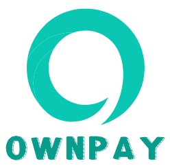
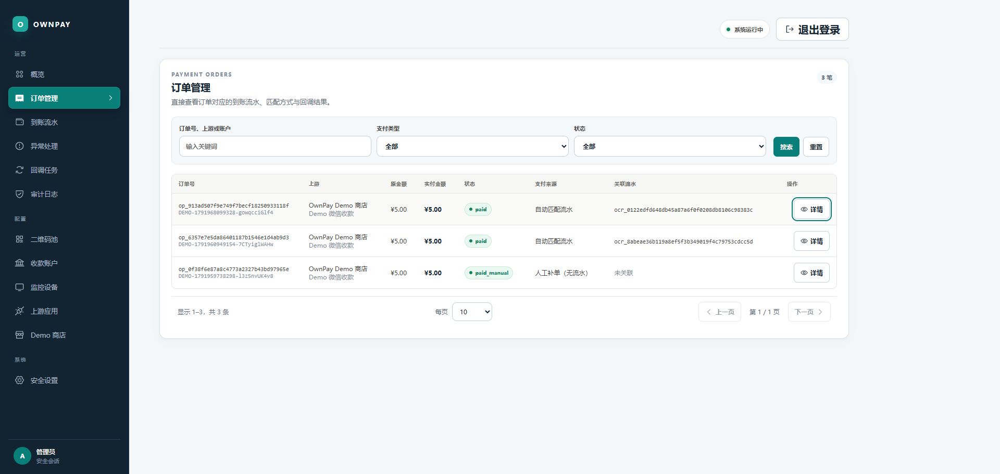
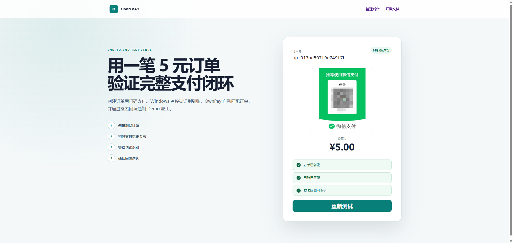
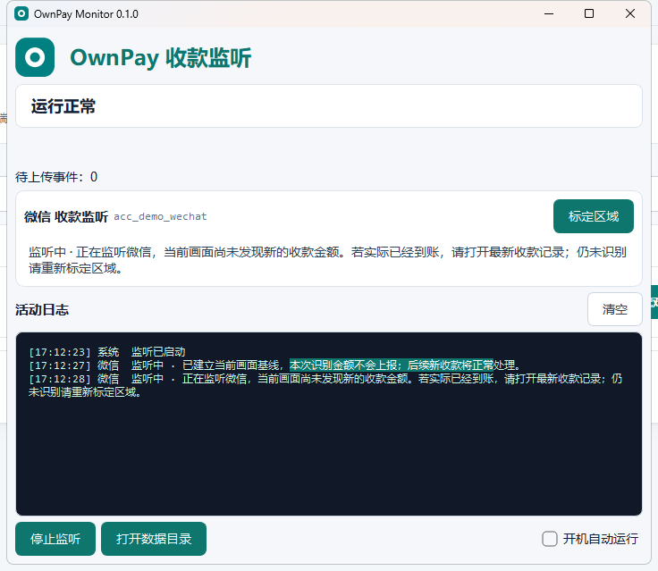
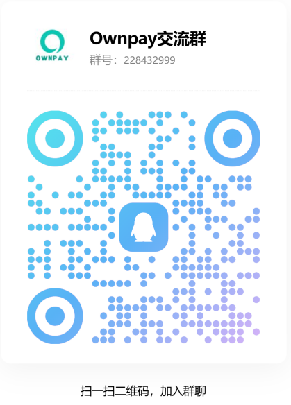

  

# OwnPay
[OwnPay](https://ownpay.us.ci)是专为个人开发者、独立卖家、数字商品提供自托管一站式支付服务，快速连接各种收款码，让个人收款，也能自动发货。
OwnPay 将微信、支付宝个人收款码与业务订单连接起来，完成订单创建、到账识别、并发匹配、支付回调和异常处理。系统不代收、不参与资金清算，用户付款直接进入配置的个人收款账户。
> OwnPay 依赖客户端界面和 OCR，不是微信支付或支付宝官方支付接口。它不能提供官方服务端通知同等级别的真实性、可靠性和合规保障。订单过期、低置信度或归属不明确的款项会进入人工处理队列，不会强行自动确认。
# OwnPay Monitor

OwnPay Monitor 是 OwnPay 的 Windows 收款监控工具。它通过 OCR 识别微信、支付宝到账记录，并将结果安全提交给 OwnPay，帮助个人收款业务自动确认订单和通知发货。

## 界面预览

### 网站管理与支付体验

### PC 监控工具

## 下载

请前往 [Releases](https://github.com/mobaiit/ownpay-monitor/releases/latest) 下载最新版本：

- `OwnPayMonitor-Setup-x.x.x.exe`：安装版，适合日常使用。
- `OwnPayMonitor-Portable-x64-x.x.x.zip`：免安装版，解压后运行。
- `SHA256SUMS.txt`：安装包与便携版的文件校验值。

> Windows 10 / 11 64 位系统可用。首次使用前，请先在 OwnPay 管理后台创建 Windows OCR 监控设备并生成配对码。

## 主要能力

- 同时支持微信和支付宝到账识别。
- 可视化标定收款记录区域。
- 自动识别到账金额并匹配订单。
- 网络中断后保留待上传记录，恢复后继续提交。
- 重复到账自动去重，低置信度记录进入人工处理。
- 后台可查看设备状态、最近心跳和运行错误。

## 快速开始

1. 下载并安装 OwnPay Monitor。
2. 在 OwnPay 管理后台创建 Windows OCR 设备并生成一次性配对码。
3. 在客户端填写 OwnPay 服务地址和配对码。
4. 打开微信或支付宝收款记录页面，按引导标定识别区域。
5. 完成一笔小额测试，确认到账识别和订单匹配正常后再正式使用。

## 在线入口

- 产品首页：<https://ownpay.us.ci/>
- 使用手册：<https://ownpay.us.ci/docs>
- PC 监控工具文档：<https://ownpay.us.ci/docs?guide=pc-monitor>
- 在线体验：<https://ownpay.us.ci/demo>

## 联系与交流

- 合作咨询：QQ `656984220`
- QQ 交流群：`228432999`

  

## 使用提示

OwnPay Monitor 依赖微信、支付宝客户端界面和 OCR 识别，不是微信支付或支付宝官方支付接口。客户端界面升级可能影响识别效果，正式使用前请完成真实截图标定和小额支付验证；无法可靠识别的到账记录应进入人工核对。

本仓库仅用于公开发布 OwnPay Monitor 安装包、版本说明和用户文档，不包含 OwnPay 源代码。
